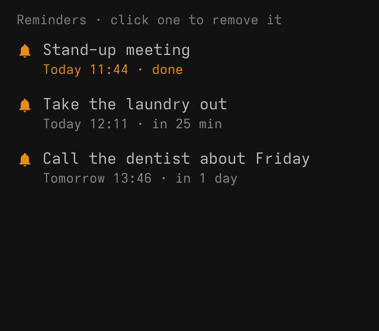
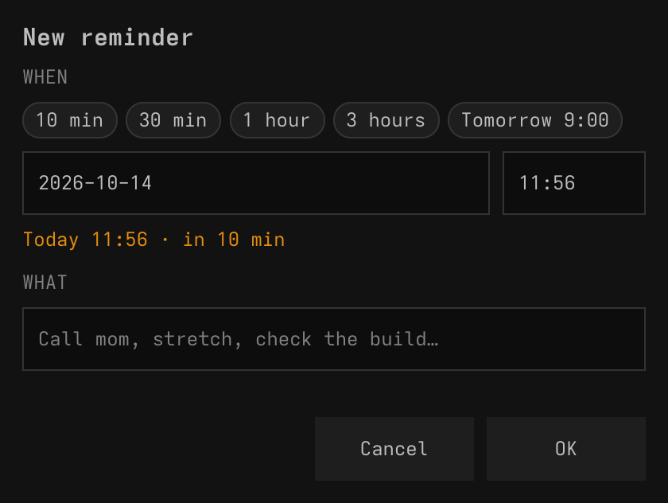

# Reminder for SUPER DESKTOP

A bell in the [SUPER DESKTOP](https://github.com/gladimdim/super-desktop) top
bar. Click it to add a reminder, right-click it to see your reminders. When
one is due you get a notification and a ding-dong, and the bell shakes until
you look.

| The bell, ringing | Right-click: your reminders | Click: a new reminder |
| --- | --- | --- |
|  |  |  |

## Use it

- **Click the bell** to add a reminder: pick 10 min, 30 min, 1 hour, 3 hours
  or tomorrow at 9:00, or type a date and time (it starts 10 minutes from
  now), write what to remind you of, and press **OK** or Enter. Esc or a click
  outside drops it.
- **Right-click the bell** to see your reminders, soonest first. Click one to
  remove it.
- **When a reminder is due** you get a desktop notification and a short
  "bzz-bzz… ding-dong", repeated every minute up to five times. In SUPER
  DESKTOP the bell shakes over a moving gradient until you click it; that
  click shows the list. The reminder stays there, marked done, until you
  remove it.

Reminders are checked while SUPER DESKTOP runs. One that came due while it was
not running goes off when it starts. Colors come from your Omarchy theme and
keep text readable in light and dark themes.

## Install

Needs SUPER DESKTOP 1.6.0 or newer (popups and button tooltips).

```sh
super-desktop plugin install https://github.com/gladimdim/super-desktop-reminder
super-desktop plugin approve reminder
```

Or approve it in Settings → Plugins, where **Ask AI to review** reads it first.

## What it does on your PC

- Saves your reminders in SUPER DESKTOP's plugin values
  (`~/.local/state/super-desktop/plugins/reminder.data.json`).
- Shows notifications through SUPER DESKTOP (`notify-send`).
- Plays `ding-dong.wav` from its own folder with `pw-play`, else `paplay`,
  else `aplay`.
- Nothing else: no network, no other files, no other programs.

## Change it

It is plain QML: edit a file and SUPER DESKTOP reloads it. `AGENTS.md`
describes how it works for an AI agent; `super-desktop plugin check reminder`
and `super-desktop plugin snapshot reminder --surface list` check your edits.
`tools/make-ding-dong.py` regenerates the sound.

## License

MIT
